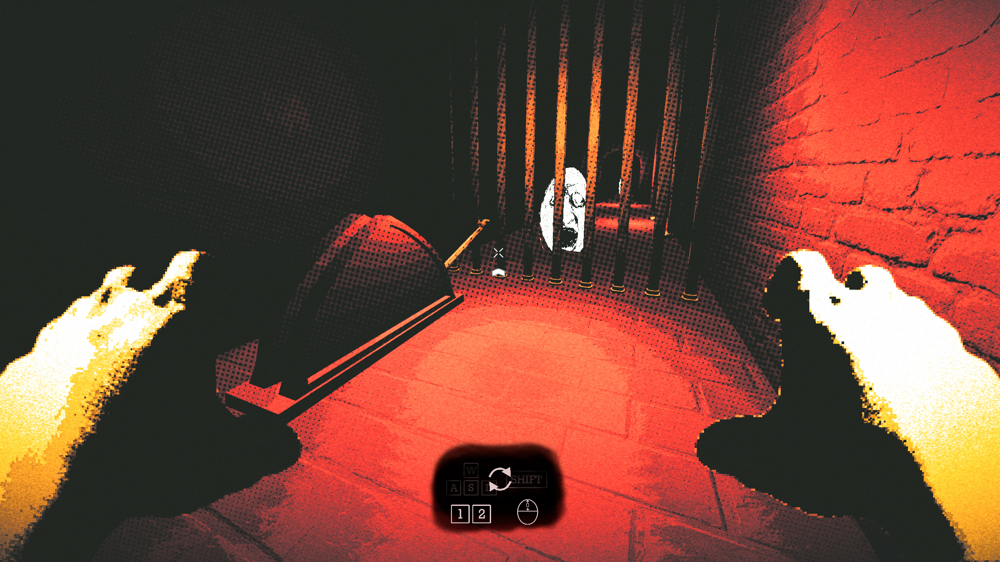
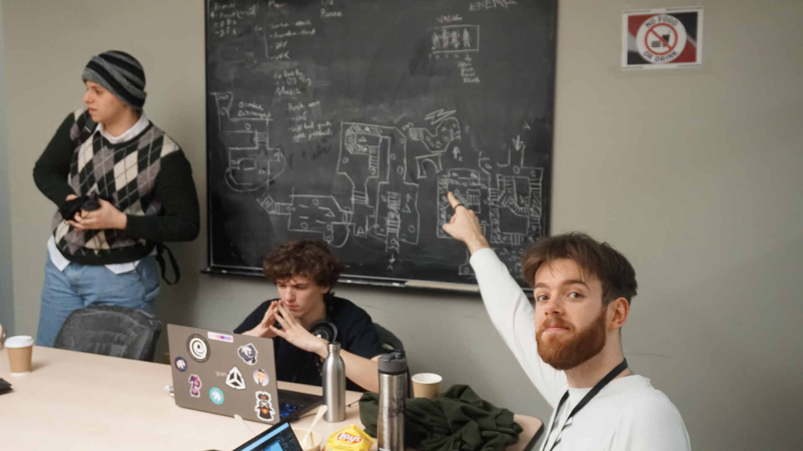
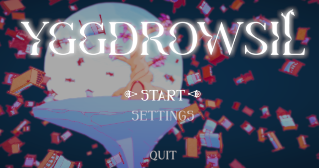
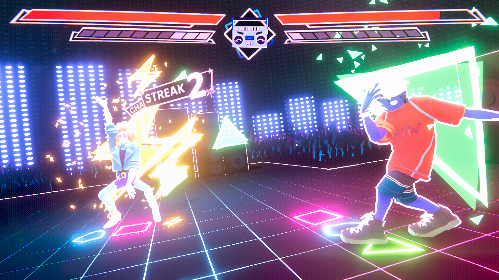
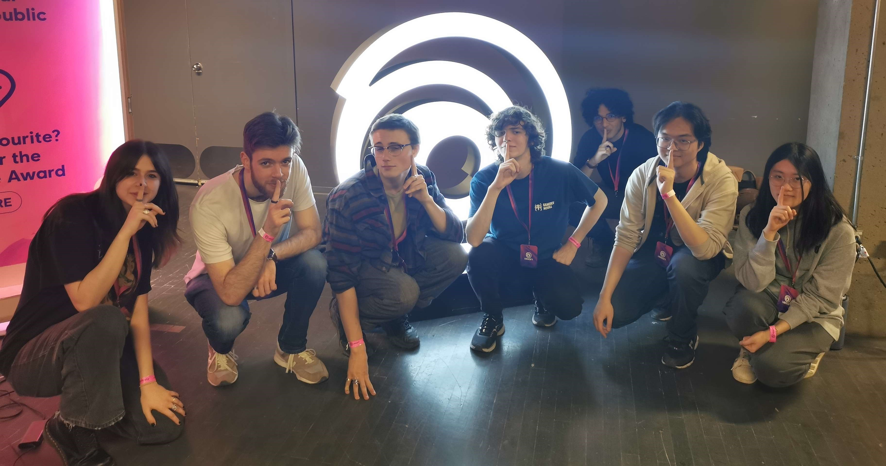
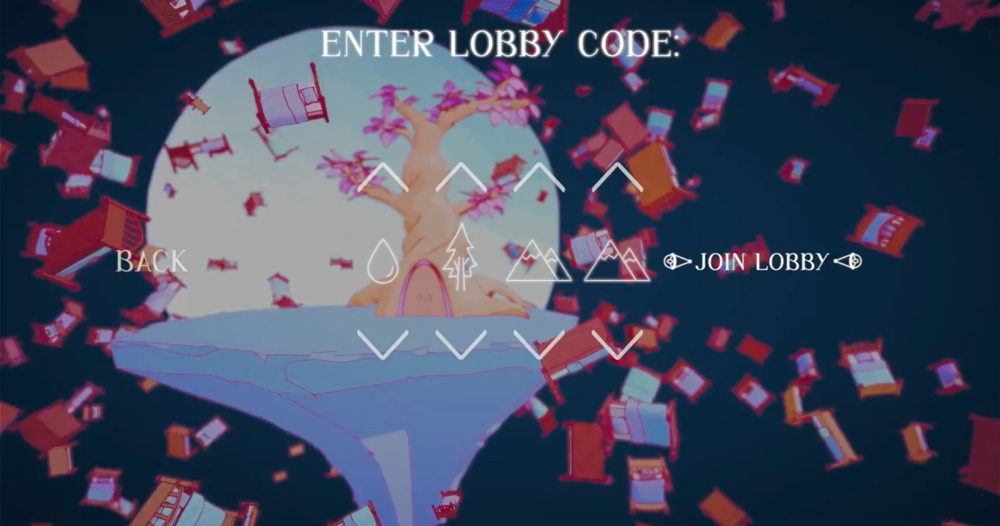
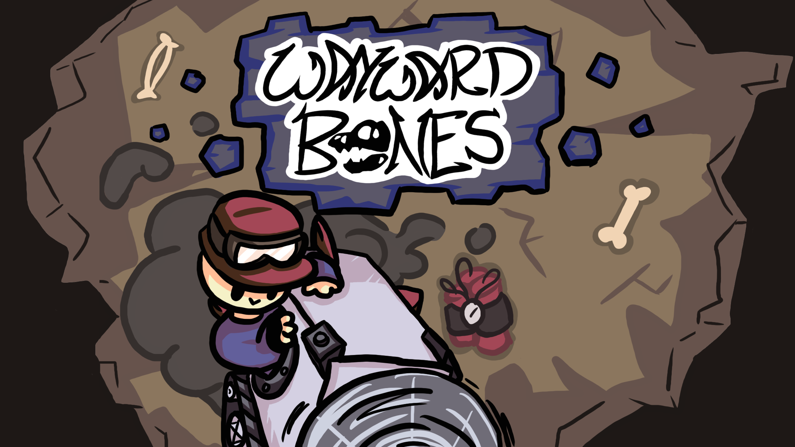
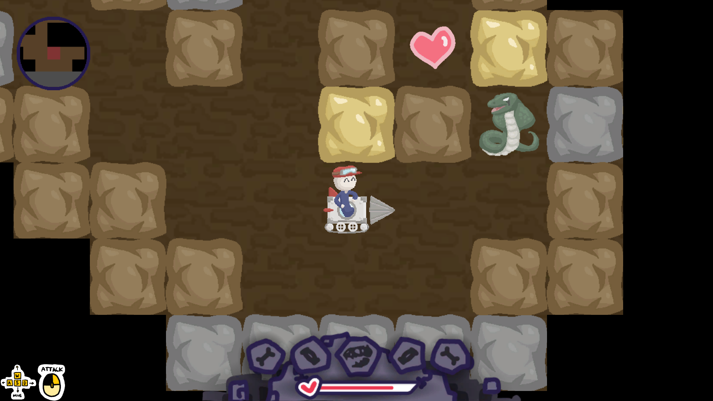
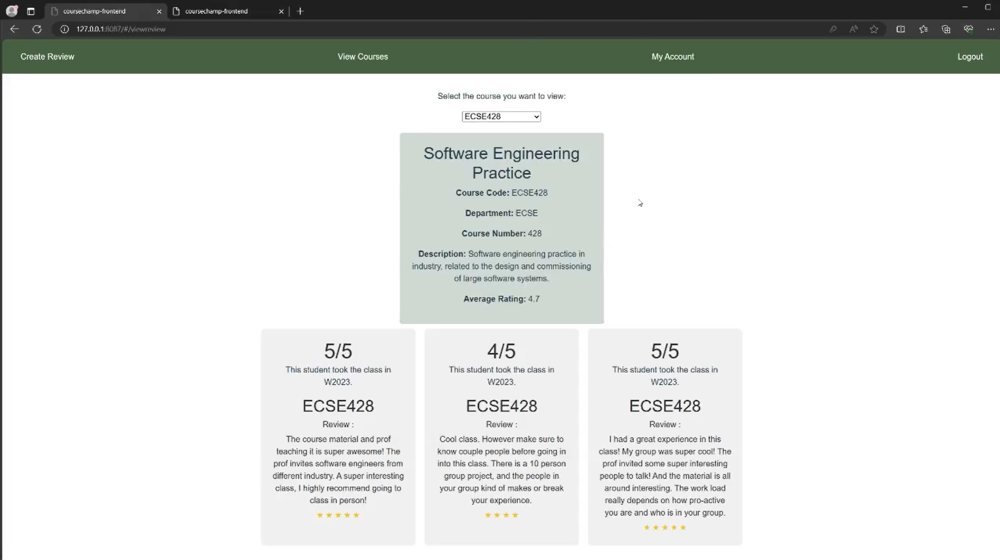
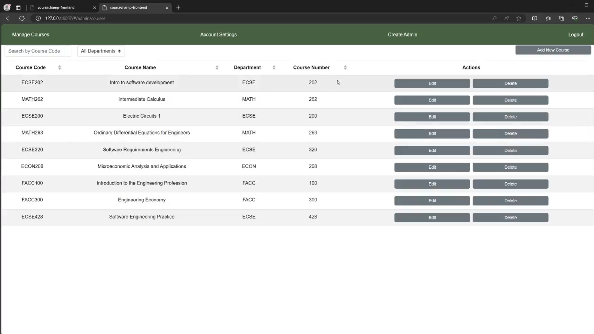

# Introduction 👋
Hello! I'm Emilien Taisne, a software engineering student at McGill. I'm passionate about game development 😊🎮 and I learn more about the industry every day.

I'm interested in the networking side of game development, such as multiplayer architecture, data synchronization and more!
Working with my peers on projects at GameDev McGill inspires me to keep working on collaborative projects.

# Technical Skills 🖥️
Game engines I am proficient in:

Programming languages I am proficient in:

Tools I use:

## Languages 🌎
English - Fluent  
French - Native  
Chinese - Intermediate (HSK 3 level)  

# Community 🤝
**President of GameDev McGill (2024–2025):** I led a team of 12 that organized events for our ~200 members throughout the year: monthly socials, charity streams, bootcamps and talks, and our annual in-person game jam, which had 215 participants.

# Some Repositories 👀
## Game Development Projects: 🎮
- [Pose Pose Execution - Ubisoft Game Lab Competition 2026](https://flyingsheep22.itch.io/pose-pose-execution) 🏆 : **Won Best User Experience and the Public Choice Award**, and was nominated for 6 other awards, including Best Prototype and Best Technical Challenge & Innovation. Pose Pose Execution is a 1v1 local multiplayer dance battle in Unity. Each round, both players secretly input 4 moves on their Xbox controller, then watch them play out: each move can inflict, block or charge, and your previous move in the round matters, a bit like a more complex rock paper scissors. This was my second Game Lab with a McGill team of 8 (4 programmers), and this time I was the **programming lead**. At the start, I worked on the **architecture** of the input and execution phase systems, and I built the **BeatManager**, which keeps the activation and animation of every object in sync with the music and lets players input their moves on the beat. As the project matured, my role became coordination: making sure every programmer had a task they wanted, that the designers' needs were met and that the artists' work made it into the game. Above all, I kept our **main branch** working: merging everyone's features, reviewing code on GitHub and making sure our main scene had the newest features without breaking.
  <!-- Add images here, e.g.    -->
- [Slaughterhouse - Unreal Engine 5](https://sel-fie.itch.io/slaughterhouse) : *"Make your way out of this house of horrors and live to crow another day."* We made this game in **Unreal Engine 5 Blueprints** during a private game jam with friends, with 2 teams of 6. I programmed most of the gameplay: **camera movement, player movement and controls, checkpoints, death and winning**.
  <!-- Add images here -->
- [I'm About to Blow - Conjure Game Jam 2026](https://sel-fie.itch.io/im-about-to-blow) ([GitHub](https://github.com/Emilien-T/BulkyBombs)) : Made in Unity for the theme *"Inconvenient Super Power"*. You quality-check bombs, but if you mess up, you transform into an easily enraged half man, half beast and have to find inner peace before continuing. I was one of the two programmers: I made **2 of the minigames** and some gameplay features, and implemented the art and animations.
  <!-- Add images here -->
- [Ouroborea - GMTK 2025](https://fshbone.itch.io/ouroborea) : We participated in the GMTK Game Jam at the start of August. I worked on coordinating the team and bringing together all the work my teammates did, and I debugged it whenever there was a problem merging features or building the game.
- [Wizard Handz - McGameJam 2025](https://github.com/CRook99/McGameJam2025) : Wizard Handz was made during McGameJam 2025, while my team and I were also volunteers and organizers for the jam, so it is a much smaller game. We just wanted to make a Doom-like game where you beat up monsters and run through rooms. I was busy at the start of the jam, so I was mostly responsible for bug fixing, which allowed us to publish the game on itch with a full game loop at the end.    
- [Yggdrowsil - Ubisoft Game Lab Competition 2024](https://github.com/Emilien-T/GameLabs2024) : Game submitted to the **Ubisoft Game Lab Competition**, made by a team of 8 with 4 programmers. I was responsible for the **multiplayer architecture** in Unity, using Unity's Netcode for GameObjects. I developed the **lobby system** so that players can connect to each other using symbols, which makes joining more accessible. I also worked on **replication**, so that every player sees the same game and sees each other using abilities, dashing, selecting levels, etc. Finally, I was in charge of **leading** the programming team, making sure we were coordinated, that everyone had work to do and that our work was merged correctly.     
- [Brazen Bull - McGameJam 2024](https://github.com/EzNoGame/McGill-Game-Jam-2024) : Made during McGameJam 2024, this was the first game with my Game Lab team. There were 8 of us, and we were testing our collaboration skills and time management, and learning each other's strengths. In the end, we made a horror puzzle game where a mechanical robot chases you around while you solve puzzles. I was responsible for leading and coordinating the team, and we had to re-scope the project and the enemy AI. It was a great learning experience for the months to come in the Game Lab competition.  
- [WayWard Bones - McGameJam 2022](https://github.com/nicktstewart/McGameJam) : This was my first game jam, and I learned so much from it. We were a team of 6, and I was responsible for most of the programming of the 2D mining part of the game. I had already done projects in Unity, but this experience really pushed me to know the engine. The hardest parts for me were the procedural generation of the map, loading and unloading the map around the player, and the "shadow" effect. I had such a good experience that I continued my journey into the game development world.    

## School Projects: 🎓
- [Raytracer - COMP 557](https://github.com/Emilien-T/COMP557RayTracer)       
- [Course Champ - ECSE 428](https://github.com/Emilien-T/CourseChamp)    
- [Parking Lot Management System - ECSE 321](https://github.com/McGill-ECSE321-W23/project-group-01)   
- [Lego Robot - ECSE 211](https://github.com/julia-b-grenier/ecse211)   
